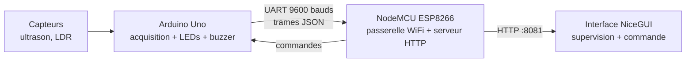

# DeliveryBot — Mise à jour, partie 1 : plateforme de communication et de collecte de données

**DeliveryBot** est un robot mobile de livraison embarqué développé à l'ENIG (École Nationale d'Ingénieurs de Gabès) : énergie solaire, supervision IoT et, à terme, navigation autonome.

Ce dépôt contient la **partie 1** de sa mise à jour : une **plateforme de supervision** qui collecte les données du robot, les transmet en WiFi et les affiche en temps réel dans une interface web, avec un premier canal de commande.

> Objectif final : faire de DeliveryBot un robot de livraison utilisable en conditions réelles, par exemple en restauration.

---

## Architecture



| Bloc | Rôle |
|---|---|
| **Arduino Uno** | Lit les capteurs (distance HC-SR04, luminosité LDR), gère l'alarme (LEDs + buzzer), simule les grandeurs énergétiques (I_PV, I_sys, V_sys, température, humidité) et envoie une trame JSON par seconde. |
| **NodeMCU ESP8266** | Reçoit les trames par UART, se connecte au WiFi et les expose sur un serveur web (`/data`). Transmet à l'Arduino les commandes reçues (`/cmd`). |
| **Node-RED** (essai) | Collecte directe des trames sur le port USB de l'Arduino : courbe de la distance et enregistrement dans un fichier CSV. |
| **Interface NiceGUI** (Python) | Tableau de bord web : mesures en temps réel, état de l'alarme et des LEDs, courbes sur 60 s. Deux profils : **utilisateur** (supervision) et **administrateur** (supervision + commandes). |

## Fonctionnalités

- Acquisition : distance d'obstacle, luminosité ambiante.
- Alarme locale : buzzer en cas d'obstacle à 10 cm ou moins, LEDs d'état.
- Données énergétiques simulées (en attendant les capteurs réels) : courant PV, courant système, tension système stabilisée à 5 V, température, humidité.
- Transmission WiFi via une passerelle ESP8266 (API HTTP JSON).
- Interface web avec connexion utilisateur / administrateur.
- Essai de collecte avec **Node-RED** : courbe en temps réel et enregistrement des mesures dans un fichier CSV (voir [nodered/](nodered/README.md)).
- Commandes administrateur : **Marche**, **Arrêt**, **Acquittement** de l'alarme, clavier 1–9.

## Structure du dépôt

```
deliverybot-plateforme-iot/
├── arduino/arduino_vers_esp/          Code Arduino Uno (capteurs, LEDs, buzzer, envoi JSON)
├── esp8266/esp8266_serveur/           Code NodeMCU ESP8266 (WiFi, serveur HTTP, relais UART)
├── interface/
│   ├── interface_nicegui.py           Tableau de bord web (Python / NiceGUI)
│   └── requirements.txt
├── nodered/                           Essai de collecte avec Node-RED (flux + explications)
├── outils/diagnostic_uart_esp8266/    Outil de test de la liaison Arduino → ESP8266
└── docs/cablage.md                    Câblage détaillé et dépannage
```

## Câblage


| Arduino Uno | NodeMCU ESP8266 | Remarque |
|---|---|---|
| D13 (TX) | D5 (RX) | via un **pont diviseur** 5 V → 3,3 V |
| D12 (RX) | D6 (TX) | fil direct |
| GND | G | masse commune obligatoire |

Capteurs : HC-SR04 (Trig D2, Echo D4), LDR (A0), buzzer (D8), LEDs rouge D6 / verte D7 / jaune D11.
Détails : [docs/cablage.md](docs/cablage.md).

## Mise en route

### 1. Arduino Uno
Ouvrir `arduino/arduino_vers_esp/arduino_vers_esp.ino` dans l'IDE Arduino, carte **Arduino Uno**, puis téléverser.
Le moniteur série (9600 bauds) affiche une trame JSON par seconde.

### 2. NodeMCU ESP8266
1. Dans l'IDE Arduino, ajouter l'URL des cartes :
   `https://arduino.esp8266.com/stable/package_esp8266com_index.json`
   puis installer **esp8266 by ESP8266 Community** (Gestionnaire de cartes).
2. Ouvrir `esp8266/esp8266_serveur/esp8266_serveur.ino` et renseigner `WIFI_SSID` / `WIFI_PASS` (réseau **2,4 GHz**).
3. Carte **NodeMCU 1.0 (ESP-12E Module)**, téléverser, puis ouvrir le moniteur (115200 bauds) et noter l'adresse affichée (`IP:8081`).

### 3. Interface web
```bash
cd interface
python -m pip install -r requirements.txt
python interface_nicegui.py
```
Ouvrir http://localhost:8090, saisir l'adresse `IP:8081` du NodeMCU, puis se connecter.
Le PC doit être sur le même réseau WiFi que le NodeMCU.

> Les comptes de démonstration (`admin` / `user`) sont définis en haut de `interface_nicegui.py` : changez les mots de passe avant toute utilisation réelle.

## API du NodeMCU

| Requête | Réponse |
|---|---|
| `GET /` | Page de test (nombre de trames reçues, dernière trame) |
| `GET /data` | Dernière trame JSON de l'Arduino + `age_ms` (âge de la trame) |
| `GET /cmd?c=MARCHE` | Commande transmise à l'Arduino (`MARCHE`, `ARRET`, `ACQ`, `TOUCHE:1..9`) |

Exemple de trame :
```json
{"distance":24.3,"luminosite":258,"sombre":0,"alarme":"ATTENTION","buzzer":0,"acquitte":0,
 "systeme":"MARCHE","led_rouge":0,"led_verte":1,"led_jaune":0,"touche":0,
 "temperature":25.4,"humidite":54.8,"I_PV":1.62,"I_sys":0.85,"V_sys":5.01,"age_ms":120}
```

## Feuille de route

- [x] **Partie 1 — Communication et collecte de données** : liaison Arduino ↔ ESP8266, transmission WiFi, tableau de bord web, premières commandes à distance.
- [ ] **Partie 2 — Commande** : pilotage du robot depuis la plateforme (moteurs, déplacements).
- [ ] **Parties suivantes** : capteurs énergétiques réels, navigation autonome, sécurisation des échanges, vers un robot de livraison adapté à la restauration.

## Auteur

Réalisé par **Malek Chihi** — ENIG, département Génie Électrique — Automatique.
